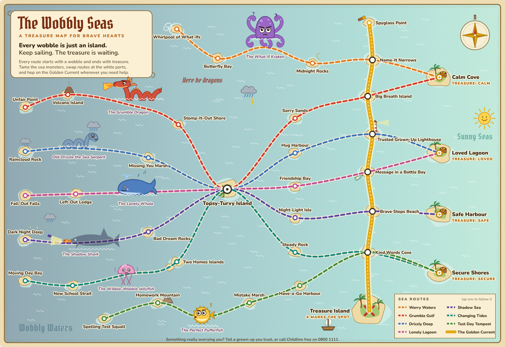

# Mind the Map: The Inner Underground

An underground-style map of the hard feelings everyone passes through. Anxiety, low mood, exam and work pressure, traffic, relationships, parenting and the urge to escape all run on one network. Every feeling is a stop. None of them is the end of the line.


## What is in it

- **The map**: 8 lines, about 60 stations, drawn with 45 degree track like the real thing. Tap any station to see *what it feels like* and *mind the gap* (the way through). Tap a line in the key to follow it end to end.
- **Journey planner**: pick where you are and where you want to be. It finds the route with the fewest stops and changes, and shows the lesson at each station on the way. Popular journeys are one tap away.
- **Poster capture**: an email form that unlocks the full-size SVG poster (prints sharp at A2 or A1) and a print-to-PDF version.
- **Crisis signposting** on Rock Bottom, on the poster and in the footer (Samaritans 116 123).

## The lines

| Line | Covers | Runs from | To |
| --- | --- | --- | --- |
| Worry Line (yellow) | Anxiety | What If? | Calm |
| Low Line (navy) | Depression and low mood | Heavy Mornings | First Light |
| Pressure Line (red) | Exams, study and work | Deadline | Enough |
| Gridlock Line (grey) | Traffic, commuting and waiting | Traffic Jam | Open Road |
| Heart Line (pink) | Relationships | Loneliness | Connection |
| Family Line (green) | Children and parenting | Tantrum Terrace | Little Joys |
| Escape Line (purple) | When you need a way out | Get Me Out of Here | Wonder |
| Growth Overground (orange) | Healing, from anywhere | Awareness | Becoming |

Every coloured line crosses the Growth Overground once, so there is always a way to start growing from wherever you are. The Low Line dips to Rock Bottom and climbs from there, on purpose.

## Editing the map

Everything lives in `public/index.html`. The `LINES` and `STATIONS` objects near the top of the script hold all the copy and coordinates (a 1600 x 1100 canvas). Keep consecutive stops horizontal, vertical or exactly diagonal and the track stays tidy; `l` sets which side the label sits on.

## The Wobbly Seas: a treasure map for children (8 to 13)

Served at `/treasure-map/`. Same idea, younger crew: a pirate map where every route starts with a wobble in the stormy west, sails past a friendly sea monster and ends at a treasure island in the sunny east. The language is written for 8 to 13 year olds, so it says "worried", "cross", "sad" and "scared", never adult labels.



| Route | Covers | Sea monster (tame it, never fight it) | Treasure |
| --- | --- | --- | --- |
| Worry Waters | Worries and what-ifs | The What-If Kraken | Calm Cove |
| Grumble Gulf | Feeling cross | The Grumble Dragon | Calm Cove |
| Drizzly Deep | Feeling sad, missing someone | Old Drizzle the Sea Serpent | Loved Lagoon |
| Lonely Lagoon | Falling out, feeling left out | The Lonely Whale | Loved Lagoon |
| Shadow Sea | Feeling scared, bad dreams | The Shadow Shark | Safe Harbour |
| Changing Tides | Moving, new school, two homes | The Wibble-Wobble Jellyfish | Secure Shores |
| Test Day Tempest | Tests, homework, mistakes | The Perfect Pufferfish | Secure Shores |
| The Golden Current | Helpers that work anywhere | none | Treasure Island (X marks the spot) |

What is on the page: the tappable map (islands give a captain's tip, monsters give "how to tame it"), a voyage planner where a little ship sails the route, a "fill your own treasure chest" activity that saves on the device and prints, a short guide for grown-ups, the same poster email capture (`source: "wobbly-seas"`), and Childline (0800 1111) signposting. Sea routes only sail one way, towards treasure; the Golden Current runs both ways.

To edit it, everything lives in `public/treasure-map/index.html`: `ROUTES` and `PLACES` near the top of the script hold all the copy and positions on a 1600 x 1100 canvas. Routes are smooth curves, so any coordinates work.

## Running it

Zero dependencies. Node 18 or newer.

```bash
npm start            # http://localhost:3000
```

| Env var | What it does |
| --- | --- |
| `PORT` | Port to listen on (Railway sets this for you) |
| `DATA_DIR` | Folder for `subscribers.jsonl` (default `./data`). Mount a Railway volume here so sign-ups survive redeploys. |
| `SUBSCRIBE_WEBHOOK_URL` | Optional. Each sign-up is also POSTed here as JSON, so you can pipe it into ConvertKit, Mailchimp, Zapier or Make. |

Endpoints: `GET /health`, `POST /api/subscribe` (`{ "email": "...", "name": "..." }`).

## Deploying to Railway

Create a new project from this repo. Railway detects the `start` script and sets `PORT`. Add a volume mounted at `/data`, set `DATA_DIR=/data`, and optionally set `SUBSCRIBE_WEBHOOK_URL`.

## A note on the design

The emblem is an open ring (the gap you mind) with a bar. It is deliberately not the TfL roundel, which is a registered trademark that TfL protects actively. Keep it that way if you change the branding.

Mind the Map is a reflection tool. It is not medical advice and does not replace a GP, therapist or counsellor.
