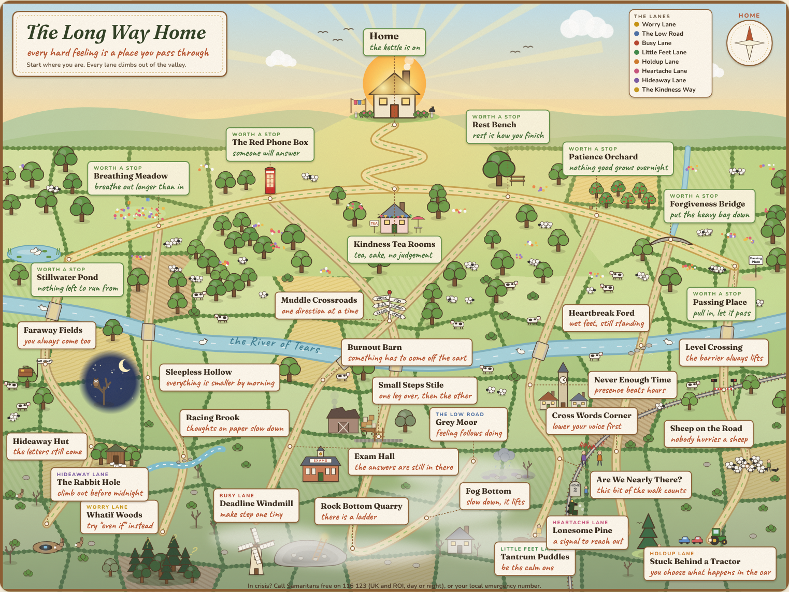

# The Long Way Home

An illustrated country map of the hard feelings everyone walks through. Every hard feeling is a place you pass through, and every lane climbs out of the valley towards a cottage on the hill with the kettle on.



## The idea

The bottom of the map is a foggy valley, and that is where the hard places are: Whatif Woods, Sleepless Hollow, Burnout Barn, Rock Bottom Quarry, Stuck Behind a Tractor. Seven country lanes climb out of it. Each one reaches the Kindness Way, a sunny ridge road lined with places worth stopping at, such as the Red Phone Box, Rest Bench and Forgiveness Bridge. From the Kindness Tea Rooms, Home Lane winds up the hill to the cottage.

Every place on the map has a hand-lettered reframe on its sign ("Burnout Barn: something has to come off the cart"), plus a fuller "what it feels like" and "the way through" when you tap it.

## The lanes

| Lane | Covers | Starts at | Climbs to |
| --- | --- | --- | --- |
| Worry Lane | Anxiety and worry | Whatif Woods | Breathing Meadow |
| The Low Road | Depression and low mood | Grey Moor | The Red Phone Box |
| Busy Lane | Exams, study and work | Deadline Windmill | Rest Bench |
| Little Feet Lane | Children and parenting | Tantrum Puddles | Patience Orchard |
| Holdup Lane | Traffic, commuting and waiting | Stuck Behind a Tractor | Passing Place |
| Heartache Lane | Relationships | Lonesome Pine | Forgiveness Bridge |
| Hideaway Lane | When you need to escape | The Rabbit Hole | Stillwater Pond |

Busy Lane and The Low Road meet at Muddle Crossroads (overwhelm), where the signpost points everywhere at once. The Low Road drops right down into Rock Bottom Quarry, which has a ladder up the side.

## What else is on the page

- **Walk me home.** Pick where you are. It plans the way with the fewest stops, lists every sign, then a little walker and their dog walk it on the map while a guide card reads each reframe.
- **Life in the valley.** The windmill turns, smoke rises from the chimneys, ducks paddle, a steam train runs along the railway, the fog drifts and the stars twinkle over Sleepless Hollow.
- **Poster capture.** An email form unlocks the full-size SVG poster (prints sharp at A2 or A1) and a print-to-PDF version.
- **Crisis signposting** on Rock Bottom Quarry, the Red Phone Box, the poster and the footer (Samaritans 116 123, SHOUT 85258).

## Editing the map

Everything lives in `public/index.html`. The `NODES` object holds each place's name, sign reframe (`sub`), panel copy (`feel` and `gap`), illustration (`icon`) and position on a 1600 x 1200 canvas. `LANES` lists the places each lane passes through, in order. Illustrations are small drawing functions in `ICONS`. Pictures and signs place themselves to avoid the lanes and each other, and the trees, sheep and cows are scattered into whatever space is left, so you can move or add places freely.

## Running it

Zero dependencies. Node 18 or newer.

```bash
npm start            # http://localhost:3000
```

| Env var | What it does |
| --- | --- |
| `PORT` | Port to listen on (Railway sets this for you) |
| `DATA_DIR` | Folder for `subscribers.jsonl` (default `./data`). Mount a Railway volume here so sign-ups survive redeploys. |
| `SUBSCRIBE_WEBHOOK_URL` | Optional. Each sign-up is also POSTed here as JSON, so you can pipe it into ConvertKit, Mailchimp, Zapier or Make. |

Endpoints: `GET /health`, `POST /api/subscribe` (`{ "email": "...", "name": "..." }`).

## Deploying to Railway

Create a new project from this repo. Railway detects the `start` script and sets `PORT`. Add a volume mounted at `/data`, set `DATA_DIR=/data`, and optionally set `SUBSCRIBE_WEBHOOK_URL`.

The Long Way Home is a reflection tool. It is not medical advice and does not replace a GP, therapist or counsellor.
